# Baby_Duck: Scanner y Parser (Entrega 1)

Herramienta usada: **PLY** (Python Lex-Yacc). Genera un scanner con `ply.lex`
y un parser LALR(1) con `ply.yacc`.

## 1. Cómo se dieron de alta las expresiones regulares (scanner)

Archivo: `src/lexer.py`

- Todos los tokens se declaran en la lista `tokens`.
- Tokens simples: variables `t_NOMBRE = r'regex'`.
- Tokens con acción: funciones `t_NOMBRE(t)` con la regex en el docstring.
- Palabras reservadas: diccionario `reserved`. Se reconocen como `ID` y después
  se cambia su tipo si la palabra está en el diccionario.
- `t_ignore` ignora espacios y tabs; `t_ignore_COMMENT` ignora comentarios `//`;
  `t_newline` cuenta líneas; `t_error` marca caracteres ilegales.

| Token         | Expresión regular                                                     |
|---------------|-----------------------------------------------------------------------|
| ID            | `[a-zA-Z_][a-zA-Z0-9_]*`                                              |
| CTE_INT       | `[0-9]+`                                                              |
| CTE_FLOAT     | `[0-9]+\.[0-9]+`                                                      |
| CTE_STRING    | `"[^"\n]*"`                                                           |
| Comentario    | `//[^\n]*` (se ignora)                                                |
| Operadores    | `=  +  -  *  /`                                                       |
| Comparación   | `>  <  !=  ==  >=  <=`                                                |
| Delimitadores | `;  ,  :  (  )  {  }`                                                 |
| Reservadas    | `program main end var int float void print read while if else return` |

- `CTE_FLOAT` se define antes que `CTE_INT` porque PLY prueba las funciones en
  orden; si no, `3.14` se cortaría en `3` y `.`.
- Los operadores de dos caracteres (`==`, `<=`, `>=`, `!=`) ganan sobre los de uno
  porque PLY ordena los tokens simples de la regex más larga a la más corta.

## 2. Cómo se dieron de alta las reglas gramaticales (parser)

Archivo: `src/parser.py`

- Cada regla es una función `p_nombre(p)` y la regla va en su docstring:
  `'assign : ID ASSIGN expresion SEMICOLON'`.
- Las alternativas (`|`) van en líneas separadas del mismo docstring.
- ε se escribe con la regla `empty :`.
- La primera regla del archivo (`program`) es el símbolo inicial.

Gramática final:

```
program        : PROGRAM ID ; vars_opt func_list MAIN body END
vars_opt       : vars | ε
vars           : VAR decl decl_list
decl_list      : decl decl_list | ε
decl           : ID id_list : type ;
id_list        : , ID id_list | ε
type           : INT | FLOAT
func_list      : funcs func_list | ε
funcs          : func_type ID ( params ) { func_body }
func_type      : VOID | type
params         : ID : type params_list | ε
params_list    : , ID : type params_list | ε
func_body      : VAR decl local_decls | statement_list
local_decls    : decl local_decls | statement_list
body           : { statement_list }
statement_list : statement statement_list | ε
statement      : assign | condition | cycle | f_call | print | read | return
assign         : ID = expresion ;
condition      : IF ( expresion ) body
               | IF ( expresion ) body ELSE body
cycle          : WHILE ( expresion ) body
f_call         : call ;
call           : ID ( args )
args           : expresion args_list | ε
args_list      : , expresion args_list | ε
print          : PRINT ( print_item print_list ) ;
print_item     : expresion | CTE_STRING
print_list     : , print_item print_list | ε
read           : READ ( ID ) ;
return         : RETURN expresion ;
expresion      : exp rel_opt
rel_opt        : > exp | < exp | != exp | == exp | >= exp | <= exp | ε
exp            : termino exp_list
exp_list       : + termino exp_list | - termino exp_list | ε
termino        : factor termino_list
termino_list   : * factor termino_list | / factor termino_list | ε
factor         : ( expresion ) | ID | sign ID | cte | sign cte | call
sign           : + | -
cte            : CTE_INT | CTE_FLOAT
```

PLY genera la tabla sin conflictos (0 shift/reduce, 0 reduce/reduce).

## 3. Cambios respecto a los diagramas

| Cambio               | Antes                               | Ahora                              | Motivo                                                          |
|----------------------|-------------------------------------|------------------------------------|-----------------------------------------------------------------|
| `return`             | no existía                          | `return x + 1;`                    | Agregado en el diagrama actualizado                             |
| Signo en FACTOR      | `SIGN_OPT -> + \| - \| ε`           | `ID \| sign ID \| cte \| sign cte` | El ε causaba un conflicto shift/reduce con la llamada a función |
| Llamada en expresión | `x = g(1); + 2;`                    | `x = g(1) + 2;`                    | Solo lleva `;` cuando es estatuto                               |
| if / else            | `if (c) s1; else s2;;`              | `if (c) { ... } else { ... }`      | Llaves obligatorias: elimina el `;;` y la ambigüedad del else   |
| while                | `while (c) do s;;`                  | `while (c) { ... }`                | Igual que if: sin `do`, llaves obligatorias                     |
| Bloque `[ ]`         | `[ s1; s2; ]`                       | eliminado                          | Las llaves `{ }` ya cumplen esa función                         |
| Funciones            | `int f() [ var t : int; { ... } ];` | `int f() { var t : int; ... }`     | Más fácil de leer y escribir                                    |
| Comparaciones        | `>  <  !=`                          | `>  <  !=  ==  >=  <=`             | Permite comparar igualdad y rangos                              |
| Comentarios          | no existían                         | `// texto`                         | Documentar el código                                            |

## 4. Test plan

Ejecución: `python3 -m unittest -v tests/test_babyduck.py`

- `tests/valid/`: 16 programas que deben ser aceptados.
- `tests/invalid/`: 25 programas que deben ser rechazados.
- Pruebas del scanner: reservadas vs ID, números, operadores, comparaciones de dos
  caracteres, comentarios, delimitadores, strings, número de línea y caracteres
  ilegales.

Principales test-cases:

| Archivo                        | Entrada clave                                        | Esperado          |
|--------------------------------|------------------------------------------------------|-------------------|
| valid/05_assign_expr           | `y = -x + (x - 1) / 2;`                              | Aceptado          |
| valid/08_print                 | `print("x =", x, x + 1);`                            | Aceptado          |
| valid/09_fcall                 | `h();`  `x = g(x) + 1;`                              | Aceptado          |
| valid/10_full                  | programa completo con vars, función, read, if, while | Aceptado          |
| valid/11_return                | `return a * 2;`                                      | Aceptado          |
| valid/12_nested_if             | if anidado con `{ }`                                 | Aceptado          |
| valid/14_comments              | `x = 1; // comentario`                               | Aceptado          |
| valid/15_comparisons           | `if (x == y) { ... }`                                | Aceptado          |
| valid/16_func_locals           | función con `var` locales y estatutos                | Aceptado          |
| invalid/01_lex_illegal_char    | `1 @ 2`                                              | Error léxico      |
| invalid/02_lex_bad_float       | `3.`                                                 | Error léxico      |
| invalid/04_missing_semicolon   | `read(x)`                                            | Error de sintaxis |
| invalid/08_keyword_as_id       | `var while : int;`                                   | Error de sintaxis |
| invalid/12_double_relational   | `1 < 2 < 3`                                          | Error de sintaxis |
| invalid/13_return_without_expr | `return;`                                            | Error de sintaxis |
| invalid/19_if_without_braces   | `if (x > 0) x = 1;`                                  | Error de sintaxis |
| invalid/21_old_while_do        | `while (x > 0) do { ... }`                           | Error de sintaxis |
| invalid/25_var_after_statement | declaración después de un estatuto                   | Error de sintaxis |

Resultado: todas las pruebas pasan (OK).

---

# Baby_Duck: Semántica de variables (Entrega 2)

Archivos nuevos: `src/semantic_cube.py`, `src/symbols.py`.
Archivos modificados: `src/parser.py` (puntos neurálgicos), `src/main.py` (opción `--symbols`).

## 5. Cubo semántico

Archivo: `src/semantic_cube.py`

**Tipos:**
- `int` y `float`: los únicos tipos con los que se puede declarar una variable.
- `bool`: tipo interno. Nadie lo puede declarar; es el resultado de una
  comparación y el tipo que necesitan las condiciones de `if` y `while`.
- Los strings (`CTE_STRING`) no están en el cubo: solo pueden aparecer dentro
  de `print`, nunca se opera con ellos.

**Tabla 1. `+  -  *`**

| izq \ der | int   | float | bool  |
|-----------|-------|-------|-------|
| int       | int   | float | error |
| float     | float | float | error |
| bool      | error | error | error |

**Tabla 2. `/`**

| izq \ der | int   | float | bool  |
|-----------|-------|-------|-------|
| int       | int   | float | error |
| float     | float | float | error |
| bool      | error | error | error |

**Tabla 3. `>  <  >=  <=`**

| izq \ der | int   | float | bool  |
|-----------|-------|-------|-------|
| int       | bool  | bool  | error |
| float     | bool  | bool  | error |
| bool      | error | error | error |

**Tabla 4. `==  !=`**

| izq \ der | int   | float | bool  |
|-----------|-------|-------|-------|
| int       | bool  | bool  | error |
| float     | bool  | bool  | error |
| bool      | error | error | error |

**Tabla 5. `=`** (izquierda: la variable que recibe; derecha: el tipo del valor)

| variable \ valor | int   | float | bool  |
|------------------|-------|-------|-------|
| int              | int   | error | error |
| float            | float | float | error |
| bool             | error | error | error |

**Tabla 6. Signo unario (`+x`, `-x`)**

| operando | `+` / `-` |
|----------|-----------|
| int      | int       |
| float    | float     |
| bool     | error     |

**Decisiones:**
- Si un lado es `float`, el resultado es `float`: así no se pierden decimales.
- `int / int` da `int` (división entera, como en C: `7 / 2 = 3`), porque
  BabyDuck se diseñó con comportamiento tipo C.
- `bool` no es un número: no se puede usar en aritmética, ni ordenar (`>` `<`),
  ni con signo.
- `bool == bool` es error. Es alcanzable con paréntesis (`(a > b) == (c > d)`),
  pero se deja fuera para mantener el lenguaje simple.
- Asignación: un `int` cabe en un `float` (`5` se vuelve `5.0`); un `float` en
  un `int` perdería los decimales, así que es error. Un `bool` no se puede guardar
  porque ninguna variable puede ser `bool`.
- El signo no cambia el tipo de un número.

**Reglas fuera del cubo** (no son "dos tipos dan un tipo"; se validarán en la
Entrega 3, cuando se conozca el tipo de cada expresión):
- La condición de `if` y `while` debe ser `bool`.
- `print` acepta `int`, `float`, `bool` y strings.
- `read(x)`: `x` puede ser `int` o `float`.
- `return expr;` sigue la tabla de `=`, como si se asignara al tipo de retorno de
  la función: `return 5;` en una función `float` es válido, `return 2.5;` en una
  función `int` es error.
- `return` en una función `void` o en `main` es error.
- Una función `void` no se puede usar dentro de una expresión (no tiene valor).

**Estructura elegida:** un diccionario de Python con llave
`(tipo_izq, operador, tipo_der)` y valor el tipo resultante. El signo unario usa
un diccionario aparte con llave `(operador, tipo)`, porque tiene un solo operando.

- Por qué un diccionario: la consulta es O(1).
- Por qué llave tupla y no diccionarios anidados (`cubo[op][izq][der]`): una sola
  consulta, sin tener que validar cada nivel.
- Por qué solo las combinaciones válidas: la mayoría de las celdas son error; no
  guardarlas deja la tabla compacta. Si la llave no existe, el resultado es `error`.
- Los operadores que comparten tabla se agrupan en tuplas (`ARITHMETIC`,
  `ORDERING`, `EQUALITY`) y el cubo se llena con un ciclo por grupo.

**Operaciones:**
- `result_type(izq, op, der)`: regresa el tipo resultante o `error`.
- `unary_type(op, operando)`: igual para el signo.

## 6. Directorio de Funciones y Tablas de Variables

Archivo: `src/symbols.py`

```
FunctionDirectory
    funcs     dict  nombre -> FuncInfo
    program   nombre de la entrada del programa (alcance global)
    current   nombre del alcance que se está llenando

FuncInfo     name, type ('int'|'float'|'void'|'program'), line,
             params (lista de tipos en orden), vars (VarTable)

VarTable
    vars      dict  nombre -> VarInfo

VarInfo      name, type ('int'|'float'), kind ('global'|'param'|'local'), line
```

Ejemplo para `tests/valid/10_full.bd`:

```
demo (program, globals)
    x          int    global
    y          int    global
    z          float  global
f : void (int, float)
    a          int    param
    b          float  param
    t          int    local
```

**Por qué estas estructuras**

| Qué | Estructura | Por qué |
|-----|------------|---------|
| Directorio de funciones | Tabla hash (`dict`) | Cada llamada busca la función por nombre: búsqueda e inserción O(1), y detectar un duplicado es un `in`. |
| Tabla de variables | Tabla hash (`dict`) | Cada uso de una variable es una búsqueda por nombre. Python conserva el orden de inserción, útil para imprimir y, más adelante, para asignar direcciones en orden. |
| Una tabla por función | `VarTable` dentro de cada `FuncInfo` | Cada función tiene su propio alcance, y su tabla viaja con ella. |
| Alcance actual | Nombre (`current`) en vez de una pila de tablas | BabyDuck solo tiene dos niveles (global y función) y no permite funciones anidadas; basta con la tabla actual y la global. |
| Variables globales | Tabla de la entrada `program` | Todas las tablas se manejan igual, y el nombre del programa queda reservado. |
| Parámetros | Lista ordenada de tipos (`params`) + filas `param` en la tabla | El orden importa para validar llamadas (`f(x, y)`), y un diccionario no sirve para eso. También van en la tabla porque dentro de la función se usan como variables. |
| Filas | `dataclass` (`VarInfo`, `FuncInfo`) | Registros con campos con nombre, fáciles de extender en las siguientes entregas (dirección virtual, cuádruplo de inicio, tamaño). |

**Operaciones principales**

| Operación | Qué hace | Error que detecta |
|-----------|----------|-------------------|
| `start_program(nombre)` | Crea la entrada del programa; se vuelve el alcance actual | |
| `add_function(nombre, tipo)` | Inserta la función y la vuelve el alcance actual | Función doblemente declarada, o con el nombre del programa |
| `add_param(nombre, tipo)` | Inserta en la tabla de la función y agrega el tipo a `params` | Parámetro repetido |
| `add_var(nombre, tipo)` | Inserta en la tabla del alcance actual (`global` o `local`) | Variable doblemente declarada en el mismo alcance (incluye local con el nombre de un parámetro) |
| `end_function()` | Regresa al alcance global | |
| `lookup_var(nombre)` | Busca en la tabla local y luego en la global | Variable no declarada |
| `lookup_func(nombre)` | Busca la función en el directorio | Función no declarada |
| `dump()` | Imprime el directorio (`python3 src/main.py archivo.bd --symbols`) | |

**Reglas de alcance:**
- Una variable local o un parámetro puede llamarse igual que una global; dentro
  de la función se usa la local (la búsqueda empieza por la tabla local).
- Dos funciones pueden tener locales con el mismo nombre (son tablas distintas).
- Una función se puede llamar a sí misma (recursión), porque se registra antes de
  leer su cuerpo.
- Una función debe declararse antes de ser llamada.
- Funciones y variables son espacios de nombres distintos: una global `f` y una
  función `f` pueden coexistir, porque una llamada siempre lleva `(`.

## 7. Puntos neurálgicos

PLY genera un parser bottom-up: el código de una regla se ejecuta cuando la regla
se reduce, es decir, cuando ya se leyó toda su parte derecha. Para que algo ocurra
**a la mitad** de una regla (crear la función antes de leer sus parámetros), esa
parte se separa en una regla propia (`program_header`, `func_header`). La tabla
LALR sigue con 0 conflictos.

```
program        : program_header ; vars_opt func_list MAIN body END
program_header : PROGRAM ID                                  <- NP1
decl           : ID id_list : type ;                         <- NP2
func_header    : func_type ID                                <- NP3
params         : ID : type params_list | ε                   <- NP4
funcs          : func_header ( params ) { func_body }        <- NP5
read           : READ ( ID ) ;                               <- NP6
assign         : ID = expresion ;                            <- NP6
factor         : ID | sign ID | ...                          <- NP6
call           : ID ( args )                                 <- NP7
```

| NP  | Regla | Cuándo se ejecuta | Acción |
|-----|-------|-------------------|--------|
| NP1 | `program_header` | Después de `program nombre` | Crea el directorio y la entrada del programa (alcance global) |
| NP2 | `decl` | Al terminar cada declaración (`;`) | Inserta cada nombre con su tipo en la tabla del alcance actual |
| NP3 | `func_header` | Después de `tipo nombre` de una función | Inserta la función con su tipo de retorno; se vuelve el alcance actual |
| NP4 | `params` | Al terminar la lista de parámetros | Inserta los parámetros en la tabla y su tipo en `params`, en orden |
| NP5 | `funcs` | Al cerrar la función (`}`) | El alcance actual vuelve a ser el global |
| NP6 | `read`, `assign`, `factor` | Al usar una variable | Verifica que esté declarada (local o global) |
| NP7 | `call` | Al terminar una llamada | Verifica que la función exista y reciba tantos argumentos como parámetros |

**Detalles de implementación:**
- En `decl` el tipo viene al final (`a, b, c : int;`), así que `id_list` regresa
  en `p[0]` la lista de nombres (con su línea) y se insertan todos al reducir `decl`.
- `params_list` es recursiva por la derecha, así que se reduce de derecha a
  izquierda (primero el último parámetro). Por eso regresa una lista y los
  parámetros se insertan juntos al reducir `params`, en el orden correcto.
- `type` y `func_type` regresan su lexema (`'int'`, `'float'`, `'void'`) en `p[0]`.
- `args` y `args_list` regresan el número de argumentos.
- `parse()` crea un directorio nuevo en cada llamada y lo regresa.
- Los errores semánticos lanzan `SemanticError` con la línea; `main.py` los
  imprime igual que los de sintaxis.

## 8. Test plan (Entrega 2)

Ejecución: `python3 -m unittest -v tests/test_babyduck.py`

- `tests/semantic/`: 15 programas sintácticamente correctos que deben dar error semántico.
- `tests/valid/17` a `20`: casos de alcance que deben ser aceptados.
- Pruebas unitarias del cubo semántico (todas las tablas) y del contenido del directorio.
- `valid/12_nested_if` e `invalid/16_call_semicolon_in_expr` ahora declaran las
  funciones que llaman, para que sigan probando lo mismo que en la Entrega 1.

| Archivo | Entrada clave | Esperado |
|---------|---------------|----------|
| semantic/01_dup_global | `var x : int; x : float;` | Variable doblemente declarada |
| semantic/02_dup_same_line | `var a, b, a : int;` | Variable doblemente declarada |
| semantic/03_dup_local | local repetida en una función | Variable doblemente declarada |
| semantic/04_dup_param | `void f(a : int, a : float)` | Parámetro repetido |
| semantic/05_local_same_as_param | `void f(a : int) { var a : float; }` | Variable doblemente declarada |
| semantic/06_dup_function | `void f()` y `int f()` | Función doblemente declarada |
| semantic/07_function_named_like_program | `program p; void p() { }` | Nombre ya usado por el programa |
| semantic/08_undeclared_assign | `y = 1;` sin declarar `y` | Variable no declarada |
| semantic/09_undeclared_in_expr | `x = y + 1;` | Variable no declarada |
| semantic/10_undeclared_read | `read(z);` | Variable no declarada |
| semantic/11_undeclared_function | `f();` sin declarar `f` | Función no declarada |
| semantic/12_wrong_arg_count | `f(x)` con `f(a, b)` | Número de argumentos incorrecto |
| semantic/13_local_not_visible_in_main | local de `f` usada en `main` | Variable no declarada |
| semantic/14_param_not_visible_in_other_func | parámetro de `f` usado en `g` | Variable no declarada |
| semantic/15_call_before_declared | `f` llama a `g`, declarada después | Función no declarada |
| valid/17_shadowing | parámetro `x` oculta la global `x` | Aceptado |
| valid/18_same_local_in_two_funcs | `t` local en `f` y en `g` | Aceptado |
| valid/19_recursion | `fact` se llama a sí misma | Aceptado |
| valid/20_globals_in_func | una función modifica una global | Aceptado |

Ejemplo de salida:

```
$ python3 src/main.py tests/valid/10_full.bd --symbols
tests/valid/10_full.bd: OK, program accepted
demo (program, globals)
    x          int    global
    y          int    global
    z          float  global
f : void (int, float)
    a          int    param
    b          float  param
    t          int    local

$ python3 src/main.py tests/semantic/01_dup_global.bd
tests/semantic/01_dup_global.bd: Semantic error at line 3: variable 'x' already declared in this scope (line 2)
```

Resultado: todas las pruebas pasan (OK).

---

# Baby_Duck: Generación de cuádruplos (Entrega 3)

Alcance de esta entrega: expresiones aritméticas y relacionales, y los estatutos
lineales (asignación, `read`, `print`). Los estatutos `if` / `while` (saltos con
`GOTOF` / `GOTO`) y las funciones (`ERA`, `PARAM`, `GOSUB`) quedan para las
siguientes entregas: por ahora sus expresiones sí generan cuádruplos, pero el
resultado solo se valida y se descarta (Q15, Q16).

Archivos: `src/quadruples.py` (estructuras) y `src/parser.py` (puntos neurálgicos).

## 9. Estructuras de datos

### 9.1 Cuádruplo (`Quadruple`)

Una instrucción con a lo más una operación: `(operador, izquierdo, derecho, resultado)`.

- Es una **clase** y no una tupla, porque en la Entrega 4 hay que modificar el
  resultado de un cuádruplo ya generado (rellenar el destino de un `GOTOF`).
- Una casilla vacía se guarda como `None` y se imprime como `-`.
  Ejemplos: `(=, t1, -, x)`, `(print, x, -, -)`, `(read, -, -, x)`.
- Por ahora las casillas guardan nombres (`'a'`, `'t1'`) y constantes (`5`, `2.5`).
  En una entrega posterior guardarán direcciones virtuales; la clase no cambia.

### 9.2 Pila (`Stack`)

Estructura LIFO (el último que entra es el primero que sale), guardada en una
lista de Python cuyo final es el tope.

| Operación | Qué hace |
|-----------|----------|
| `push(x)` | Pone `x` en el tope |
| `pop()` | Quita y regresa el tope |
| `top()` | Regresa el tope sin quitarlo |
| `is_empty()`, `len()` | Consultan si hay elementos |

`pop()` y `top()` sobre una pila vacía lanzan un error con mensaje claro: eso solo
pasa si un punto neurálgico está mal colocado.

Se usan **tres pilas**, todas de la misma clase:

| Pila | Guarda | Ejemplo |
|------|--------|---------|
| `POper` | Operadores pendientes y el fondo falso `(` | `+`, `*`, `(` |
| `PilaO` | Operandos: variables, constantes, temporales | `a`, `5`, `t1` |
| `PTypes` | El tipo de cada operando de `PilaO` (siempre del mismo tamaño) | `int`, `float`, `bool` |

### 9.3 Fila de cuádruplos (`Queue`)

Guarda los cuádruplos **en el orden en que se generan**, que es el orden en que la
máquina virtual los ejecutará (FIFO: el primero generado es el primero ejecutado).

| Operación | Qué hace |
|-----------|----------|
| `append(quad)` | Agrega un cuádruplo al final |
| `next_index()` | Número que tendrá el siguiente cuádruplo (para los saltos de la Entrega 4) |
| `fila[i]` | Lee (o modifica) el cuádruplo `i` |
| `for q in fila`, `len()` | Recorrerla e imprimirla |

- La numeración empieza en **0**.
- Nunca se le quitan cuádruplos: la fila solo crece.
- Permite acceso por índice porque en la Entrega 4 hay que regresar a rellenar
  saltos, y la máquina virtual podrá saltar hacia atrás (ciclos).

### 9.4 Generador (`QuadGenerator`)

Un objeto que contiene las tres pilas, la fila y el contador de temporales.
`parse()` crea uno nuevo para cada programa (pilas vacías, temporales desde `t1`).

| Método | Qué hace |
|--------|----------|
| `new_temp()` | Regresa `t1`, `t2`, ... |
| `generate_binary(line)` | Saca operando derecho y su tipo, operando izquierdo y su tipo, y el operador; consulta el cubo semántico; si es `error` lanza `SemanticError`; si no, crea un temporal, agrega el cuádruplo y mete el temporal y su tipo a las pilas |
| `pop_condition(line)` | Saca la condición de un `if` / `while` y verifica que sea `bool` |
| `check_empty(line)` | Verifica que las tres pilas estén vacías al terminar un estatuto; si no, indica cuál pila y qué contiene |

El derecho se saca primero porque está en el tope; por eso `a - b` genera
`(-, a, b, t1)` y no `(-, b, a, t1)`.

### 9.5 ¿Por qué pilas y por qué una fila?

Hacen trabajos distintos:

- **Las pilas son el área de trabajo.** Mientras se lee `a + b * c`, el `+` no puede
  generarse hasta saber si después viene algo de mayor prioridad. Las pilas guardan
  lo pendiente. Al terminar cada estatuto quedan vacías.
- **La fila es el resultado.** Es el programa traducido.
- Si los cuádruplos se guardaran en una pila, la máquina virtual los ejecutaría al
  revés: `(=, t2, -, a)` antes de que exista `t2`.

### 9.6 Traza: `a = b + c * d;`

| Paso | Se lee / se reduce | POper | PilaO | PTypes | Cuádruplo generado |
|------|--------------------|-------|-------|--------|--------------------|
| 1 | `b` (Q1) | | b | int | |
| 2 | fin de factor y término (Q5, Q4): `POper` vacía | | b | int | |
| 3 | `+` (Q2) | + | b | int | |
| 4 | `c` (Q1); Q5: el tope es `+`, no genera | + | b c | int int | |
| 5 | `*` (Q3) | + * | b c | int int | |
| 6 | `d` (Q1) | + * | b c d | int int int | |
| 7 | fin de factor (Q5): tope `*` | + | b t1 | int int | 0. `(*, c, d, t1)` |
| 8 | fin de término (Q4): tope `+` | | t2 | int | 1. `(+, b, t1, t2)` |
| 9 | `;` cierra la asignación (Q10) | | | | 2. `(=, t2, -, a)` |

Al final las tres pilas quedan vacías y la fila tiene el programa.

## 10. Diagramas de BabyDuck con sus puntos neurálgicos

Diagramas de todo el lenguaje (imágenes en `docs/diagramas/`).

- En **azul**, NP1 a NP7: puntos de la Entrega 2 (directorio de funciones y
  tablas de variables).
- En **rojo**, Q1 a Q17: puntos de la Entrega 3 (cuádruplos).

En `src/parser.py` cada regla tiene un comentario con el mismo número. La
descripción de cada punto está en las tablas al final de esta sección.

**PROGRAMA**


**VARS**

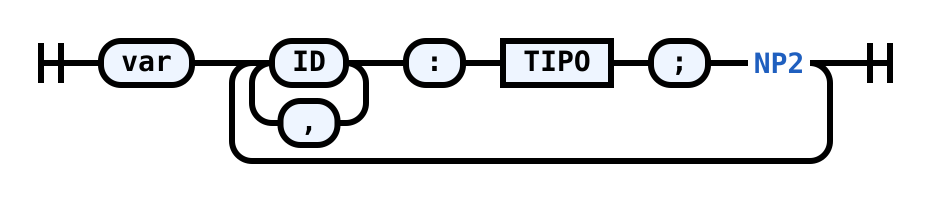

**TIPO**

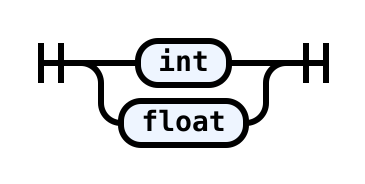

**FUNCS**

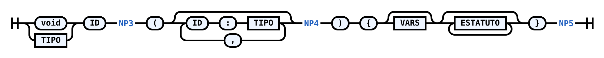

**CUERPO**

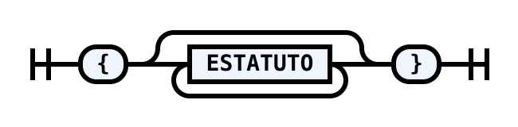

**ESTATUTO**

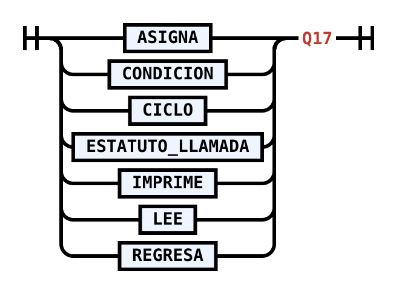

**EXPRESION**

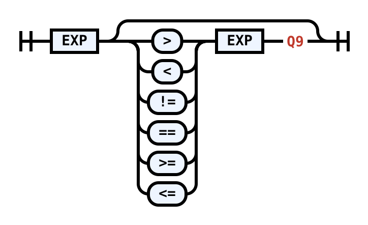

**EXP**

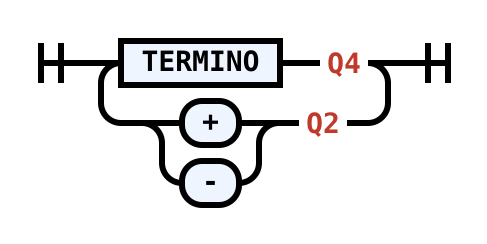

**TERMINO**

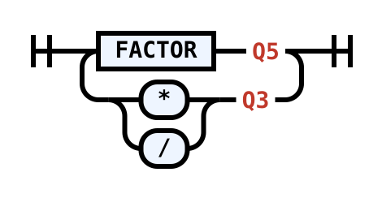

**FACTOR**

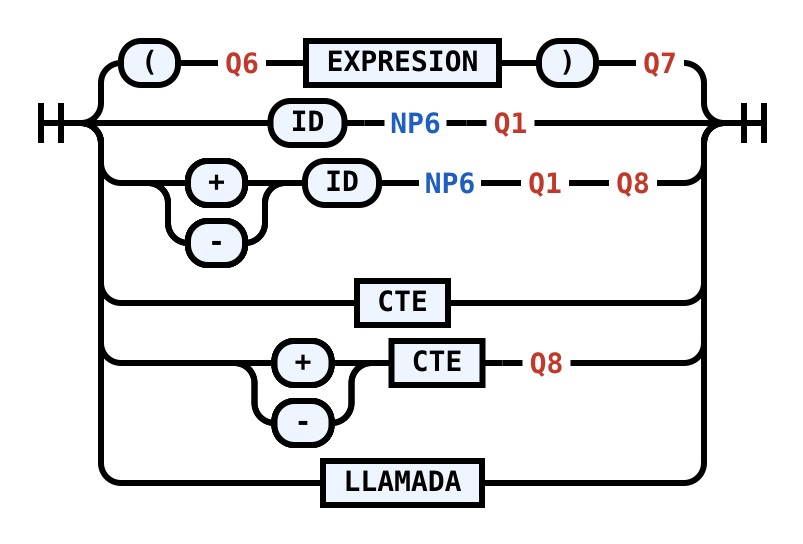

**CTE**

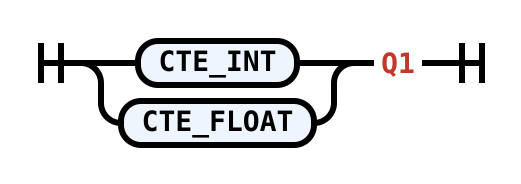

**LLAMADA** (dentro de una expresión) y como estatuto

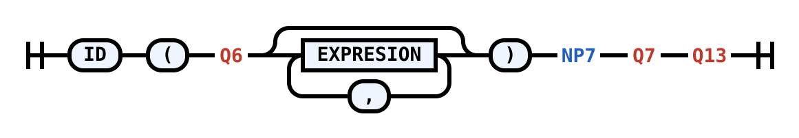

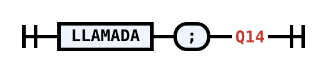

**ASIGNA**

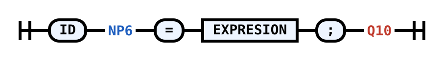

**LEE**

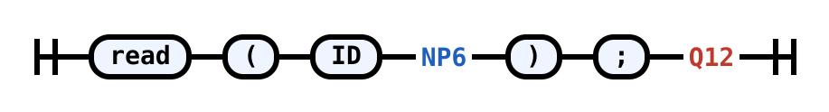

**IMPRIME**

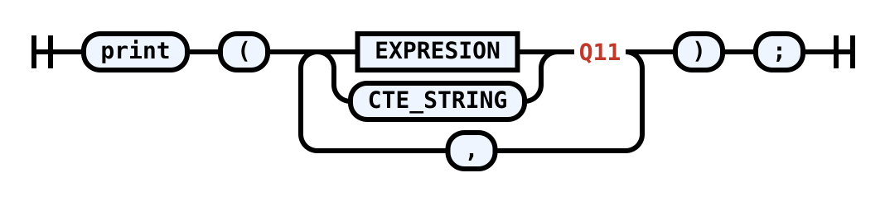

**CONDICION**, **CICLO** y **REGRESA** (solo validan y descartan su expresión en
esta entrega)

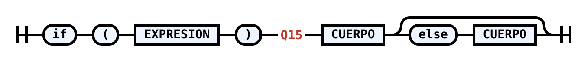


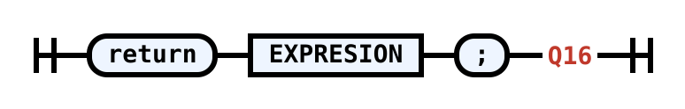

**Puntos de la Entrega 2** (detalle en la sección 7):

| Punto | Regla en `parser.py` | Acción |
|-------|----------------------|--------|
| NP1 | `program_header` | Crea el directorio de funciones y la entrada del programa (alcance global) |
| NP2 | `decl` | Inserta cada variable declarada, con su tipo, en la tabla del alcance actual |
| NP3 | `func_header` | Inserta la función con su tipo de retorno; se vuelve el alcance actual |
| NP4 | `params` | Inserta los parámetros en la tabla de la función y guarda sus tipos en orden |
| NP5 | `funcs` | Al cerrar la función, el alcance vuelve a ser el global |
| NP6 | `read`, `assign`, `factor` | Verifica que la variable usada esté declarada (local o global) |
| NP7 | `call` | Verifica que la función exista y reciba tantos argumentos como parámetros |

**Puntos de la Entrega 3:**

| Punto | Regla en `parser.py` | Acción |
|-------|----------------------|--------|
| Q1 | `factor` (ID), `cte` | Mete el operando a `PilaO` y su tipo a `PTypes` (el de la variable sale de su tabla; el de la constante, de su token) |
| Q2 | `add_op` | Mete `+` o `-` a `POper` |
| Q3 | `mult_op` | Mete `*` o `/` a `POper` |
| Q4 | `np_term` | Al terminar un término: si el tope de `POper` es `+` o `-`, genera el cuádruplo |
| Q5 | `np_factor` | Al terminar un factor: si el tope de `POper` es `*` o `/`, genera el cuádruplo |
| Q6 | `lparen` | Mete el fondo falso `(` a `POper` |
| Q7 | `factor`, `call` | Al leer `)`, saca el fondo falso |
| Q8 | `factor` (con signo) | `-5`: niega la constante en `PilaO`, sin cuádruplo. `-x`: genera `(*, x, -1, t)` |
| Q9 | `rel_opt` | Mete el operador relacional a `POper` y genera el cuádruplo (resultado `bool`) |
| Q10 | `assign` | Saca el valor y su tipo, valida `tipo_variable = tipo_valor` con el cubo y genera `(=, valor, -, variable)` |
| Q11 | `print_item` | Por cada elemento genera `(print, elemento, -, -)`; una expresión se saca de las pilas, un string se usa directo |
| Q12 | `read` | Genera `(read, -, -, variable)` |
| Q13 | `call` | Saca los argumentos de las pilas y mete el nombre de la función con su tipo de retorno (temporal hasta la entrega de funciones) |
| Q14 | `f_call` | Una llamada como estatuto: descarta el resultado que metió Q13 |
| Q15 | `if_header`, `while_header` | Al leer `)`: saca la condición y verifica que sea `bool`. Aquí irá el `GOTOF` en la Entrega 4 |
| Q16 | `return` | Saca el valor de retorno y lo descarta (el cuádruplo `RETURN` llega con las funciones) |
| Q17 | `statement` | Al terminar cualquier estatuto, verifica que las tres pilas estén vacías |

**Decisiones:**

- **Asignación:** en clase el ID se mete a `PilaO` antes del `=`. Aquí no hace falta:
  el parser es bottom-up y al reducir `assign` el nombre ya está en `p[1]`.
- **Relacionales:** el operador se mete a `POper` y se genera de inmediato, para
  reutilizar `generate_binary`.
- **Menos unario:** `-x` se traduce como `x * -1`. Así se reutiliza
  `generate_binary` y la máquina virtual no necesita un operador nuevo. Para una
  constante (`-5`) el valor se conoce al compilar, así que se niega directamente.
- **Llamadas:** su argumento es una expresión aparte; el fondo falso (Q6) evita que
  use operadores de afuera (`a * doble(2)` no debe generar `a * 2`).
- **Funciones `void` en expresiones:** su tipo es `void` y el cubo no tiene entradas
  para `void`, así que `x = f() + 1;` da error semántico sin código extra.
- **Condición de `if` / `while`:** `p_condition` se ejecuta hasta después del
  cuerpo, así que la condición se separó en `if_header` / `while_header`, que se
  reducen al leer `)`, antes del cuerpo. Así las pilas ya están vacías cuando Q17
  revisa los estatutos del cuerpo.
- **Números de línea:** `parse()` usa `tracking=True` para que PLY guarde también
  la línea de los no terminales; sin eso, los errores dentro de una expresión
  decían "line 0".
- **Limitación:** la gramática solo permite signo antes de un ID o una constante,
  no antes de un paréntesis (`-(a + b)` es error de sintaxis).

## 11. El problema de la recursión derecha

La gramática de la Entrega 1 era:

```
exp      : termino exp_list
exp_list : + termino exp_list | - termino exp_list | ε
```

PLY ejecuta el código de una regla al reducirla, y `exp_list` es recursiva por la
derecha: para `a - b - c` el `exp_list` más interno (el de `c`) se reduce
**primero**. Generar los cuádruplos en `exp_list` daría `a - (b - c)`, que es
incorrecto.

Solución: igual que `program_header` en la Entrega 2, cada parte que debe ocurrir
a tiempo se separa en una regla propia, que PLY reduce en el momento justo:

```
exp       : np_term exp_list
exp_list  : add_op np_term exp_list | ε
add_op    : + | -                      <- Q2: se reduce al leer el operador
np_term   : termino                    <- Q4: se reduce al terminar cada término
termino   : np_factor termino_list
termino_list : mult_op np_factor termino_list | ε
mult_op   : * | /                      <- Q3
np_factor : factor                     <- Q5
lparen    : (                          <- Q6
```

El mismo truco se usa para la condición de `if` / `while`:

```
condition    : if_header body | if_header body ELSE body
if_header    : IF ( expresion )           <- Q15: antes del cuerpo
cycle        : while_header body
while_header : WHILE ( expresion )        <- Q15
```

Con esto `a - b - c` genera `(-, a, b, t1)` y luego `(-, t1, c, t2)`. La tabla LALR
sigue con 0 conflictos.

## 12. Test plan (Entrega 3)

Ejecución: `python3 -m unittest -v tests/test_babyduck.py`
Ver la fila de un programa: `python3 src/main.py tests/quads/09_full.bd --quads`

- `tests/quads/`: cada `NN_nombre.bd` tiene su `NN_nombre.quads` con los cuádruplos
  esperados, escritos a mano. La prueba compila el programa, compara la fila línea
  por línea y verifica que las tres pilas terminen vacías.
- `tests/semantic/16` a `21`: errores de tipo detectados con el cubo y condiciones
  que no son `bool`.
- Pruebas unitarias de `Quadruple`, `Stack` y `Queue`.

| Archivo | Prueba | Esperado |
|---------|--------|----------|
| quads/01_precedence | `x = a + b * c - d;` | `*` antes que `+`, luego `-` |
| quads/02_parentheses | `(a + b) * (c - d)`, `a * (b + c * d)` | Fondo falso |
| quads/03_associativity | `a - b - c`, `a / b / c` | De izquierda a derecha |
| quads/04_int_float | `f = i * 2.5 + 1;`, `f = i / 2;` | Tipos del cubo, `float = int` permitido |
| quads/05_relational | `print(x > y + 1);` | Relacional después de la aritmética, tipo `bool` |
| quads/06_read_print | `read(x); print("x =", x, ...)` | Un `print` por elemento, en orden |
| quads/07_unary | `-a * b`, `-5 + a`, `a - -b` | `x * -1`; constante negada sin cuádruplo |
| quads/08_calls | `doble(x) + 1`, `x * doble(x + 1)` | Argumentos aislados por el fondo falso |
| quads/09_full | programa completo lineal | Ver salida abajo |
| quads/10_control | `if` / `else`, `while`, `return` | Cuádruplos de sus expresiones; pilas vacías |
| semantic/16_assign_float_to_int | `x = 2.5;` (x es int) | Error semántico |
| semantic/17_bool_in_arithmetic | `x = (x > 1) + 2;` | Error semántico |
| semantic/18_assign_bool | `x = x > 1;` | Error semántico |
| semantic/19_void_in_expression | `x = f() + 1;` (f es void) | Error semántico |
| semantic/20_if_not_bool | `if (x + 1) { ... }` | Error semántico: la condición debe ser `bool` |
| semantic/21_while_not_bool | `while (x) { ... }` | Error semántico: la condición debe ser `bool` |

Ejemplos de salida:

```
$ python3 src/main.py tests/quads/09_full.bd --quads
tests/quads/09_full.bd: OK, program accepted
#  op     left      right  result
0  read   -         -      x
1  *      x         2      t1
2  +      t1        1      t2
3  =      t2        -      y
4  /      y         3.5    t3
5  =      t3        -      z
6  print  "result"  -      -
7  print  z         -      -
8  >      y         10     t4
9  print  t4        -      -

$ python3 src/main.py tests/quads/02_parentheses.bd --quads
tests/quads/02_parentheses.bd: OK, program accepted
#  op  left  right  result
0  +   a     b      t1
1  -   c     d      t2
2  *   t1    t2     t3
3  =   t3    -      x
4  *   c     d      t4
5  +   b     t4     t5
6  *   a     t5     t6
7  =   t6    -      y

$ python3 src/main.py tests/quads/07_unary.bd --quads
tests/quads/07_unary.bd: OK, program accepted
#  op  left  right  result
0  *   a     -1     t1
1  *   t1    b      t2
2  =   t2    -      x
3  +   -5    a      t3
4  =   t3    -      x
5  *   b     -1     t4
6  -   a     t4     t5
7  =   t5    -      f
8  =   -2.5  -      f

$ python3 src/main.py tests/semantic/16_assign_float_to_int.bd
tests/semantic/16_assign_float_to_int.bd: Semantic error at line 3: cannot assign type 'float' to variable 'x' of type 'int'.
```
